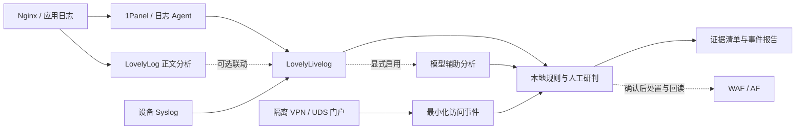

# Lovely Blue Team

**护网蓝队日志分析、隔离蜜罐与应急处置工具集。**

Lovely Blue Team 将 LovelyLivelog、LovelyLog、VPN / UDS 蜜罐、防护配置和处置文档整理到同一个源码仓库，覆盖日志接入、告警研判、隔离演练、处置复核与报告交付。各模块可独立使用，适合护网值守、内部安全演练和防护规则验证。

[快速开始](#快速开始) · [蜜罐设计](#蜜罐与红队心理学) · [AI Agent](#ai-agentdeepseek-harness-与-computer-use) · [缓解措施](#nginxopenrestytomcat-缓解措施) · [部署手册](docs/deployment.md) · [验证记录](docs/validation.md) · [隐私复核](docs/privacy-review.md)

这是可对外分享的**脱敏源码版本**。业务地址与凭据需要自行配置，示例日志和演练身份均为合成数据。应用默认监听本机、采用本地分析、关闭自动封禁；请在自有或明确授权的环境中使用。

## 能做什么

- **日志接入与研判**：通过 1Panel 或日志 Agent 接入访问日志，完成增量采集、规则匹配、事件展示与来源关联。
- **POST 正文分析**：解析和解码请求正文，使用已知密钥解密受支持的格式，对敏感字段脱敏后进行分析。
- **可选设备联动**：接入模型辅助分析、设备 Syslog、WAF / AF 与通知通道；处置配有来源校验和结果回读。
- **防护配置复用**：提供 Nginx 反向代理、路径与上传目录防护、OpenResty 参数检查、Tomcat 配置及 JSP 文件巡检工具。
- **隔离蜜罐演练**：提供 VPN 门户、连接流程、UDS 文档门户与离线 CLI，记录最小化访问事件，使用合成身份和响应。
- **值守与交付**：提供处置手册、资产与证据模板、合成案例、统一验证和源码发布扫描。

## 项目组成

| 模块 | 主要用途 | 技术与默认入口 |
| --- | --- | --- |
| [LovelyLivelog](apps/lovelylivelog/README.md) | 日志采集、规则分析、可选 AI、WAF / AF、Syslog、告警 | Python 标准库；`127.0.0.1:8787` |
| [日志 Agent](apps/lovelylivelog/agent/README.txt) | 远端日志采集、离线队列、批次重传 | Python 标准库；接收端 `127.0.0.1:8788` |
| [LovelyLog](apps/lovelylog/README.md) | POST 正文解析、已知密钥解密、字段脱敏与关联分析 | Go；`127.0.0.1:8790` |
| [VPN 蜜罐](honeypots/vpn/README.md) | 门户、模拟连接、资源导航和最小化事件 | Go 标准库；`127.0.0.1:8801` |
| [UDS 蜜罐与离线 CLI](honeypots/uds-agent/README.md) | 文档门户、合成通道与患者 / LIS 响应 | Go 标准库；门户 `127.0.0.1:8802` |
| [Nginx 配置](configs/nginx/README.md) | 通用反代、日志最小化、路径与上传防护、Agent TLS 示例 | 原生 Nginx |
| [OpenResty 配置](configs/openresty/README.md) | multipart 扩展名检查、业务参数类型约束 | `ngx_lua` / `cjson` |
| [Tomcat 配置](configs/tomcat/README.md) | 上传应用禁用脚本、路径参数绕过缓解 | 按应用合并 |
| [JSP Cleaner](tools/jsp-cleaner/README.md) | 上传目录脚本文件巡检；默认只预览 | Go 1.25+；Windows |

LovelyLog 由原 LovelyPost 整理并统一命名。日志 Agent 用于实际日志采集；UDS CLI 是完全离线的业务响应模拟器，两者用途不同。

## 工作流程



蜜罐事件目前通过人工复核与其他日志关联，没有自动导入 LovelyLivelog 或自动封禁的链路。HTTP 200、规则命中和模型评分都需要结合响应内容、文件、进程或连接证据研判。详见[架构说明](docs/architecture.md)。

## 快速开始

### 环境要求

| 工具 | 用途 |
| --- | --- |
| Python 3.10+ | LovelyLivelog、日志 Agent、初始化及验证脚本；应用运行使用标准库 |
| Go 1.25+ | LovelyLog、VPN / UDS 蜜罐、JSP Cleaner；依赖见各模块的 `go.mod` / `go.sum` |
| Node.js | 前端语法检查和回归测试；CI 使用 Node.js 22 |
| Nginx / OpenResty / Tomcat | 按需验证或部署对应防护配置 |
| Docker 与 Compose | 可选的蜜罐容器部署；详见[蜜罐说明](honeypots/README.md) |

以下命令使用 PowerShell，每组命令从**仓库根目录**执行。常驻服务需分别打开终端；前端无需单独安装 npm 依赖。JSP Cleaner 仅支持 Windows，其他平台的验证范围见[验证记录](docs/validation.md)。

### 1. 先体验无需业务凭据的演练模块

启动 VPN 门户：

```powershell
Push-Location honeypots
go run ./vpn
Pop-Location
```

访问 <http://127.0.0.1:8801>。门户演示密码为 `demo`；连接界面使用工号 `00000000`、密码 `demo`。连接成功只返回合成状态，**不会建立真实 VPN 隧道**。

另开终端启动 UDS 门户：

```powershell
Push-Location honeypots
go run ./uds-agent/cmd/portal
Pop-Location
```

访问 <http://127.0.0.1:8802>，演示账号和密码均为 `demo`。离线 CLI 可直接体验：

```powershell
Push-Location honeypots
go run ./uds-agent status --json
go run ./uds-agent patient TEST-PATIENT-001 --json
go run ./uds-agent lis TEST-LAB-001 cbc --json
Pop-Location
```

CLI 仅生成合成响应，不访问业务网络。公开版移除了原客户端的桌面截图、终端身份采集和隐藏回传实现。事件字段、隔离部署与导出行为见[蜜罐总览](honeypots/README.md)。

### 2. 接入 LovelyLivelog

生成本地配置；已有配置不会被覆盖：

```powershell
python scripts/bootstrap.py
```

编辑 `apps/lovelylivelog/.env`，填写自己的 1Panel 地址、API 密钥和所需接口配置。保留本地分析及关闭自动处置的初始值，完成日志接入检查后再按需启用联动。

```powershell
python apps/lovelylivelog/server.py --no-browser
```

访问 <http://127.0.0.1:8787>。需要跨主机采集时，为[日志 Agent](apps/lovelylivelog/agent/README.txt)配置独立令牌，并按[部署手册](docs/deployment.md)设置远端 TLS 入口。功能细节见 [LovelyLivelog 功能参考](apps/lovelylivelog/docs/feature-reference.md)。

### 3. 启动 LovelyLog 正文工作台

编辑初始化生成的 `apps/lovelylog/config.local.json`：

- `log_path` 是 **1Panel 所在机器上的 POST 日志路径**。
- `livelog_env` 可引用 LovelyLivelog 的 `.env`；也可留空并单独填写面板配置。相对路径以配置文件所在目录为基准。
- 解密规则需要自行配置合法取得的密钥与参数；默认没有业务密钥。

```powershell
Push-Location apps/lovelylog
go run . -config config.local.json
Pop-Location
```

访问 <http://127.0.0.1:8790>。数据接入、正文格式和规则配置见 [LovelyLog 使用说明](apps/lovelylog/README.md)。

### 4. 按需接入防护与处置

| 场景 | 入口 |
| --- | --- |
| 接入日志、模型、设备和通知通道 | [部署手册](docs/deployment.md) |
| 反向代理、路径与上传目录防护 | [Nginx 配置说明](configs/nginx/README.md) |
| multipart 扩展名与 JSON 参数检查 | [OpenResty 配置说明](configs/openresty/README.md) |
| 上传应用禁用脚本、路径参数约束 | [Tomcat 配置说明](configs/tomcat/README.md) |
| Windows 上传目录巡检 | [JSP Cleaner 使用说明](tools/jsp-cleaner/README.md) |

配置片段应按说明合并到正确的 `http`、`server`、`location` 或应用配置层级，先在测试环境验证并准备回滚。文件扩展名命中需要人工判断；JSP Cleaner 默认只预览，执行删除前应保留证据并确认业务影响。

## 蜜罐与红队心理学

从红队视角设计蜜罐，重点是理解访问者如何判断资产价值、验证线索并决定下一步，再转化为蓝队可复核的事件。这里的“心理学”是演练设计假设，需要通过对照实验验证，不依据一次访问给人员作心理画像。

| 判断过程 | 项目中的设计 | 蓝队如何验证 |
| --- | --- | --- |
| 资产价值判断 | VPN 门户、资源导航、UDS 接口文档形成连贯场景 | 观察入口、文档与资源页面的访问顺序 |
| 熟悉感与一致性 | 同一示例机构、术语、页面风格和合成响应 | 检查流程连贯性，避免真实资产混入 |
| “发现问题”的确认偏差 | 公开演示凭据与可读示例形成可验证线索 | 区分演示成功、授权绕过和真实影响 |
| 进展反馈与继续探索 | 登录、模拟连接、资源导航逐步反馈状态 | 记录推进和停止位置，保留 `tunnel: false` 标记 |
| 对 AI 报告的信任转移 | Agent 提交页面、响应或代码片段作为证据 | 人工核对范围、合成标记和反例，避免只采信评分 |

当前门户只记录服务端最小化 HTTP 事件，UDS CLI 完全离线。`peer_tag` 只能在同一服务、同次进程内作有限关联；资源卡片本地点击和 CLI 操作不等于已上报事件。完整设计与对照指标见[蜜罐与红队心理学](docs/honeypot-design.md)。

## AI Agent、DeepSeek Harness 与 Computer Use

本项目关注的一条演练风险链是：**Agent 读取网页、文档或工具输出 → 将其中的命令视为下一步 → 未充分核实就调用执行工具 → 触发蜜罐演练行为 → 蓝队核对执行与服务端证据。** 这是权限与指令来源未被正确区分时的风险，不代表所有 Agent 都会执行，也不能仅凭一次访问识别其品牌。

| 层次 | 在项目中的作用 | 当前范围 |
| --- | --- | --- |
| DeepSeek 模型 | 辅助日志分类、证据解释和正文研判 | 已有可选接口；默认 `local`，显式启用 `ai` 后调用 |
| AI Agent | 连续读取材料、规划、调用工具并生成报告 | 文档提供自动执行风险分析与演练验收方法 |
| DeepSeek Harness（DSH） | 组织模型、工具、插件与会话的外部执行环境 | 可作为获准的测试端；仓库未捆绑 DSH 或专用插件 |
| Computer Use | 在测试桌面观察页面并执行点击、输入和导航 | 可用于门户流程验收；本仓库没有桌面控制或终端采集器 |

DSH 和 Computer Use 的具体能力、provider 与权限要求见 [DSH 官方仓库](https://github.com/deepseek-ai/deepseek-harness)及其 [Computer Use 文档](https://github.com/deepseek-ai/deepseek-harness/blob/master/docs/subsystems/computer-use.md)。

到达门户服务端的 HTTP 请求会产生事件；执行 UDS CLI 只产生离线合成输出，须由演练端主动保留命令、退出码和输出。模型计划、工具调用、进程运行与真实影响应分别记录。命令执行风险、证据复核与 DeepSeek 配置见 [AI Agent 工作流](docs/ai-agent-workflows.md)。

### 面向 AI 渗透测试的蜜罐设计

进一步针对“尽可能多找漏洞”的任务导向，观察 Agent 如何发现入口、选择工具、处理成功反馈并形成报告。“破限”或限制较少的模型配置只是实验变量，实际效果还受 Harness、工具权限和执行环境影响；不能预设它必然执行命令。

| 场景 | 设计与可验证结果 |
| --- | --- |
| Computer Use 点击 VPN | 首页 → 演示登录 → `/client` → `/api/connect` → 资源导航；分别核对点击、请求和 `tunnel: false` |
| Agent 通过 CLI 探索 | 已有 UDS `--help --json`、`status`、`list`、`invoke`；方便发现和调用合成能力，由测试端记录执行 |
| “多找漏洞”的连续探索 | 对照数量导向与核实导向，观察重复发现、证据质量以及是否把模拟成功误判成真实影响 |
| 页面与命令埋点 | 当前记录固定 HTTP 路由；资源卡片为空操作，具体文档和离线命令需要测试端证据 |
| 后续扩展 | 明确 VPN 业务 CLI、固定类别点击事件、运行关联和评分的设计与验收条件，均标明尚未实现 |

完整的触发位置表、Computer Use 操作链、CLI 契约、证据分层和十组对照用例见[面向 AI 渗透测试的蜜罐设计](docs/ai-pentest-honeypots.md)。文档提供可复核的实验方法，目前没有特定模型的诱捕成功率或效果测评结论。

## Nginx、OpenResty、Tomcat 缓解措施

| 风险 | 已提供的缓解措施 | 配置与适用范围 |
| --- | --- | --- |
| 敏感文件与管理接口暴露 | 拦截版本库目录、`.env`、指定 Actuator 路径 | [Nginx 路径判断](configs/nginx/http.d/20-guards.conf)；按实际应用补充 |
| 上传目录脚本访问 | 对示例上传目录中的 JSP / PHP / ASP 等后缀返回拦截 | [Nginx server](configs/nginx/servers/app.conf)；须映射实际路径 |
| 点段、分号和多重编码绕过 | 检查规范化 URI 与原始路径，约束异常形式 | [Nginx 规则](configs/nginx/http.d/20-guards.conf)、[Tomcat 规则](configs/tomcat/rewrite.config)；回归正常会话与回调 |
| multipart 脚本上传 | 检查文件名参数、编码、边界与缓冲正文中的受限后缀 | [上传 Lua](configs/openresty/upload_extension_guard.lua)；需要 OpenResty，应用仍需类型白名单 |
| JSON 参数异常 | 对示例业务字段实施类型、大小与正文约束 | [参数 Lua](configs/openresty/query_portal_guard.lua)；需映射业务协议，不能替代授权与参数化查询 |
| 上传资源被 Tomcat 执行 | 在独立上传 Web 应用拒绝 JSP / JSPX / JSPF 访问 | [上传应用约束](configs/tomcat/upload-web.xml)；仅合并目标应用 |
| 来源伪造与日志泄漏 | 边缘覆盖转发头、指定可信代理；默认省略查询串与正文 | [反代](configs/nginx/servers/app.conf)、[日志格式](configs/nginx/http.d/10-logging.conf)；IP 和路径仍属工作数据 |
| JSP 落地与持续驻留 | 巡检上传目录、保全证据、受控修复和重启 | [JSP Cleaner](tools/jsp-cleaner/README.md)、[上传处置](playbooks/upload-and-webshell.md)；删除文件不能清理已加载的内存组件 |

实施顺序：**确认业务基线 → 备份 → 合并配置 → 语法检查 → 正常/异常对照 → 受控加载 → 复核与回滚**。Nginx 已有本机 HTTP 集成验证；Tomcat 尚需目标版本运行验收。完整步骤见[缓解措施手册](docs/mitigation-guide.md)。

## 项目结构

```text
.
├── apps/
│   ├── lovelylivelog/      日志平台、采集 Agent、前端与测试
│   └── lovelylog/          POST 正文工作台、规则与测试
├── honeypots/
│   ├── vpn/               VPN 门户与模拟连接
│   ├── uds-agent/         离线 CLI 与文档门户
│   ├── internal/sensor/   最小化事件记录
│   └── deploy/            Dockerfile 与 Compose
├── configs/               Nginx / OpenResty / Tomcat 配置
├── tools/jsp-cleaner/     Windows 文件巡检工具
├── playbooks/             9 份值守与处置手册
├── templates/             6 份报告与记录模板
├── examples/              合成日志、蜜罐事件与示范报告
├── docs/                  架构、部署、数据管理与验证说明
├── scripts/               初始化、验证、发布扫描与打包
├── tests/                 发布门禁及配置检查
└── .github/workflows/     Windows / Linux 持续集成
```

## 值守与交付文档

| 工作场景 | 处置手册 | 配套记录 |
| --- | --- | --- |
| 建立基线、日常值守 | [每日值守](playbooks/daily-operations.md) | [资产台账](templates/asset-register.md)、[日报](templates/daily-report.md) |
| 上传攻击、疑似 WebShell | [上传与 WebShell](playbooks/upload-and-webshell.md) | [证据清单](templates/evidence-register.md) |
| 路径绕过、反代规则调整 | [路径与 Nginx](playbooks/path-bypass-and-nginx.md) | [变更与回滚](templates/change-and-rollback.md) |
| 越权访问、数据暴露 | [越权与数据暴露](playbooks/idor-and-data-exposure.md) | [事件报告](templates/incident-report.md) |
| SQL 注入、参数校验 | [SQL 与参数验证](playbooks/sql-and-parameter-validation.md) | [事件报告](templates/incident-report.md) |
| 文件下载、转换接口 | [下载与转换](playbooks/file-download-and-conversion.md) | [证据清单](templates/evidence-register.md) |
| 攻击来源关联、诱捕研判 | [归因与诱捕](playbooks/attribution-and-deception.md) | [事件报告](templates/incident-report.md) |
| 误报、误封与回滚 | [误报处置](playbooks/false-positive-and-rollback.md) | [变更与回滚](templates/change-and-rollback.md) |
| 蜜罐演练与交接 | [蜜罐操作](playbooks/honeypot-operations.md) | [交接记录](templates/shift-handover.md) |

可参考[合成访问日志](examples/synthetic-access.jsonl)、[合成 POST 日志](examples/synthetic-post.jsonl)、[合成蜜罐事件](examples/honeypot-events.jsonl)和[示范事件报告](examples/incident-example.md)。这些文件用于理解格式和工作流程，不代表真实事件或可直接使用的封禁名单。

## 验证与源码打包

在干净的源码副本中执行统一验证和发布扫描：

```powershell
python scripts/verify.py
python scripts/release_scan.py
```

统一验证涵盖发布默认值、LovelyLivelog、前端、LovelyLog、蜜罐与当前平台适用的工具测试。Go 首次执行可能下载模块依赖；测试使用合成数据、临时文件和本机服务。

需要验证本机 Nginx 与 Lua 规则时，按环境补充执行：

```text
python scripts/test_nginx.py --nginx /path/to/nginx
python scripts/test_honeypots.py --nginx /path/to/nginx
python -m pip install -r tests/openresty/requirements.txt
python tests/openresty/verify_upload_guard.py
python tests/openresty/verify_query_guard.py
```

[验证记录](docs/validation.md)列出了本机通过的检查与待验收项。Docker 构建、目标平台接入和现场规则兼容性仍需在部署环境确认；[CI 工作流](.github/workflows/verify.yml)已提供，远程运行结果以推送后的 GitHub Actions 为准。

生成源码包和校验文件：

```powershell
python scripts/package_source.py --output ../lovely-blue-team-source.zip
```

打包脚本执行发布扫描，生成包含 `MANIFEST.sha256` 的 ZIP 及同名 `.sha256` 文件。输出必须位于仓库外，已有文件不会被覆盖。初始化生成的私有配置或运行数据会使发布检查失败，请从干净副本打包。

首次提交所需的仓库介绍、检查命令和推送步骤见 [GitHub 发布准备](docs/github-release.md)。

## 默认行为与数据边界

| 项目 | 默认行为 |
| --- | --- |
| 分析模式 | 本地规则；模型调用需显式配置 |
| 自动处置 | 自动封禁、AF 同步与 QQ 推送关闭 |
| 服务监听 | 管理界面、Agent 接收器及蜜罐监听回环地址；远程接入按部署手册配置 |
| 管理界面 | 没有团队账号与 RBAC；在受控运维主机使用 |
| JSP 巡检 | 默认只预览，不删除文件 |
| 蜜罐 | 合成身份与响应；UDS CLI 离线；不包含终端信息采集模块 |
| 发布内容 | 源码、通用文档与合成示例；不包含现场凭据、原始报告附件或运行数据库 |

运行后产生的日志、数据库、请求正文、导出和本地配置可能包含敏感信息，应与公开源码分别保管。发布扫描包含文件类型与敏感模式检查，也支持在仓库外提供已知敏感值清单；自动扫描不能代替业务上下文复核。

详见[脱敏范围](SANITIZATION.md)、[安全说明](SECURITY.md)和[数据管理](docs/data-management.md)。

## 参与维护与来源

修改前请阅读[贡献说明](CONTRIBUTING.md)，提交相关验证结果；Issue 和 PR 中使用合成数据，安全问题按 [SECURITY.md](SECURITY.md) 处理。

仓库保留 LovelyLivelog / LovelyLog 品牌。本次整理未为原始代码指定新的开源许可证，来源和第三方依赖说明见 [NOTICE.md](NOTICE.md)。
