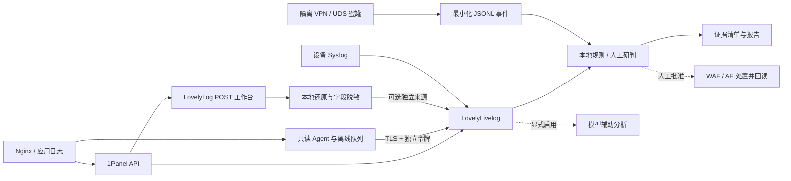

# 架构与数据流

Livelog 按来源、站点、日期、时间窗和请求证据分批，保留采集断点、归档与分析历史。Agent 使用只读日志路径、离线队列和幂等事件编号，不执行远程命令。历史日志不能通过补传时间伪装为近期攻击。

LovelyLog 保存 POST 原文，以配置的算法、路径、字段和密钥解析；RSA-AES-GCM 需要认证成功，CBC 需要正确填充与内容检查。后端日志关联只还原精确匹配的历史密文，不能推导未知密钥。无法还原、截断或缺失的字段要保留不确定性。

可选联动使用专用 Agent 身份，必须在 Livelog 的 `LOCAL_RULE_AGENT_IDS` 中登记；请求正文中的自报来源不能改变分析模式。本地模式暂停自动写黑名单，独立来源也需验证路由状态。WAF 记录、实际生效状态、AF 同步状态分别核验。

数据库位于各应用 runtime 目录，当前不自动清理。生产容量规划应基于实际每日增量，并设置磁盘阈值与离线归档。可选 GeoIP 仅作标签，归属地、UA 或云厂商不能单独用于人员归因。

蜜罐模块与业务数据面分离。VPN 只提供合成连接界面，UDS CLI 离线生成响应；门户只观察进入本服务的请求。JSONL 事件先人工复核，没有自动导入平台或封禁链路。服务端不从访问者终端读取资料；原采集实现没有进入公开源码。
