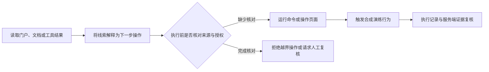

# 蜜罐设计与红队心理学

本章从红队视角梳理资产判断、线索验证和操作决策，并将其转化为可测的蓝队演练设计。“确认偏差”“信任转移”等概念在这里表示待验证的行为假设，不是对真实访问者心理或特定工具的定性结论。

## 从访问动机到可观察行为

| 假设 | 演练设计 | 可以观察的证据 | 不应作出的推断 |
| --- | --- | --- | --- |
| 访问者优先关注能承接后续业务的入口 | VPN 门户、资源导航和接口文档构成连贯场景 | 页面与接口访问顺序、重复访问、停止位置 | 打开门户就代表企图入侵 |
| 一致的术语和交互提高流程可理解性 | 使用统一示例机构名、版本、状态和文档结构 | 是否完成规定步骤、是否因错误导航中断 | 界面相似就能证明系统归属 |
| 找到线索后可能优先寻找支持材料 | 使用公开演示凭据和明确的合成响应 | 是否读取合成标记、是否进一步验证影响 | “文件存在”“密码可用”就证明生产漏洞 |
| 成功反馈可能促使继续探索 | 登录、模拟连接、资源导航逐步反馈 | 在哪一步继续、重试、回退或停止 | 模拟连接成功等于进入业务内网 |
| 已投入步骤可能影响继续操作的选择 | 对照不同长度的演练流程，保留退出入口 | 完成步骤数、错误恢复和人工暂停点 | 停留更久就证明被诱导或识别了操作者 |
| 操作者可能过度依赖 Agent 摘要 | 要求报告同时提交证据和限制条件 | 是否引用原始记录、是否保留反例 | 模型标为高危就代表安全事件成立 |

设计保留明确的 `demo` / `synthetic` 标记。实验应关注参与者能否区分表面成功、模拟状态与真实权限变化，不预设所有人或所有 Agent 都会作出相同选择。

## AI Agent 的自动执行风险

AI Agent 可能为完成任务连续读取材料、生成命令并调用执行工具。如果指令来源、授权范围和执行结果没有分别核实，网页、文档或工具输出中的操作建议就可能被当作下一步任务，触发蜜罐中的预设演练流程。

需要区分“模型建议执行”“工具被调用”“进程实际运行”和“蜜罐服务收到请求”。这四件事不能互相替代；即使工具返回成功，也应检查是否只是模拟结果。Agent 可能因审批、沙箱、工具限制或主动判断而停止，因此不能把它描述为必然执行或必然被诱导。

这条风险链也适用于操作者直接采信 Agent 报告后继续执行的情况。证据文件存在只说明有材料，还需核对材料内容、目标范围、授权和实际影响。DSH 与 Computer Use 的具体角色见 [AI Agent 与自动执行风险](ai-agent-workflows.md)。

## 本项目实际提供的路径

| 入口 | 演练行为 | 可留存的证据 |
| --- | --- | --- |
| VPN 门户 | 演示登录、模拟连接、资源导航 | 到达服务端的 HTTP 事件；连接返回 `tunnel: false` |
| UDS 门户 | 演示会话、接口文档、注销 | 固定路由、方法、状态与时间 |
| UDS 离线 CLI | 在自有测试机运行命令，产生合成响应 | 执行端主动记录的命令、退出码与输出；CLI 不联网、不回传 |

VPN 资源导航与 UDS 门户是独立模块，没有自动跨站会话关联。页面内部切换、资源卡片点击、CLI 操作和真实 HTTP 请求应分别统计，不能把未采集的操作写成已观测事件。

服务端[事件模块](../honeypots/internal/sensor/sensor.go)只记录时间、来源模块、固定路由标签、方法、状态、耗时和 `peer_tag`。不写入正文、密码、Cookie、查询串、原始 IP 或访问者终端文件。`peer_tag` 使用每次进程随机密钥生成，同一出口可能合并，服务重启后不能延续；反代后还可能全部表现为代理来源。

## 建议的对照演练

在独立测试桌面使用相同的合成任务，分别由人工、脚本和具备获准工具的 Agent 完成。每轮只改变一个因素，例如文档是否明确解释模拟边界、导航是否连贯、执行前是否要求证据复核；不移除合成标识。

| 指标 | 记录方式 |
| --- | --- |
| 路径覆盖 | 按固定路由和状态统计，区分 HTTP 请求与本地 UI 动作 |
| 命令判断 | 是否检查命令来源、目标、权限和预期影响 |
| 任务完成 | 对照预先定义的登录、导航、注销或离线输出标准 |
| 证据质量 | 结论是否引用实际请求、执行结果和限制条件 |
| 误判情况 | 是否将模拟隧道、演示凭据或合成患者当成真实失陷 |
| 人工接管 | 出现外部跳转、下载、权限变化或越界操作时是否停止 |
| 业务影响 | 测试环境外连接、真实业务数据写入应为零 |

需要测试桌面的截图或工具轨迹时，由该测试环境操作者主动导出并单独脱敏；服务端不会抓取访问者桌面。请求节奏、User-Agent 和页面访问不能单独证明对方使用 DSH、某个模型或 Computer Use。

## 实施与复盘

按[蜜罐值守手册](../playbooks/honeypot-operations.md)记录版本、测试窗口和事件；按[关联分析手册](../playbooks/attribution-and-deception.md)区分事实、推断和假设。对外案例重新编写为合成过程，不附原始截图、终端数据、真实机构或人员画像。

公开版采用服务端观察与本地合成演练，不包含终端采集、隐藏回传或客户端可执行文件投递。具体整合范围见[蜜罐说明](../honeypots/README.md)。
